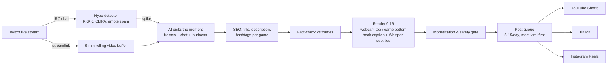

# Stream Clipper

[](https://github.com/PedroRodriguesS5/stream-clipper/actions/workflows/ci.yml)
[](LICENSE)

**An open-source, self-hosted "cortes" machine.** It watches live Twitch streams, notices when chat explodes, asks an AI to pick the best 15–90 seconds, turns it into a vertical 9:16 clip with the streamer's webcam on top, burns in Portuguese subtitles, writes the title/description/hashtags, checks it against platform rules, and posts it to **YouTube Shorts**, **TikTok** and **Instagram Reels** on a daily schedule.

Built for Brazilian Portuguese gaming streams (GTA 6 by default), but the game, language and channels are all configurable.

---

## Why open source?

Clip channels ("cortes") are a huge part of how streamers get discovered, but the tools behind them are closed, paid, and often ignore streamers' wishes. This project exists to:

- **Make clipping accessible**: everything runs on your own machine with free tools (FFmpeg, whisper.cpp, Playwright, the Claude Code CLI). No paid API keys are required.
- **Respect streamers by default**: there's a permission registry, a deny list, credit in every description, per-streamer posting delays, and a gate that refuses to post clips with third-party media, profanity, or no real transformation.
- **Be a learning project**: the code is a practical tour of child processes, FFmpeg filter graphs, HLS, IRC, LLM prompting with JSON schemas, vision models, speech-to-text, OAuth and browser automation. [`PROJECT_GUIDE.md`](PROJECT_GUIDE.md) has a study path.
- **Improve in the open**: SEO rules, platform limits and moderation heuristics change constantly. Contributions keep them current for everyone.

## How it works



1. **Discover**: finds the biggest live streams in the target category and language (or a fixed channel).
2. **Buffer**: keeps the last ~5 minutes of video on disk with `streamlink`.
3. **Detect**: a chat sensor tuned to Brazilian chat (KKKK, MDS, CLIPA…) adapts to channel size and fires on real hype spikes.
4. **Pick**: the AI (Claude Code CLI, with a local OpenAI-compatible fallback) looks at frames, chat and audio loudness and returns the clip window, what happened, and a virality score. Boring moments (menus, waiting screens) are skipped.
5. **Write SEO**: per-game vocabulary (no GTA 6 tags on a GTA RP clip), streamer name first, the search keyword in the title, real long-tail phrases, hashtags ordered most specific first. Generic clickbait phrases are banned.
6. **Fact-check**: a second vision pass checks the title against frames from the whole clip ("rodou" is not "capotou").
7. **Render**: FFmpeg reframes to 1080×1920 (webcam on top, gameplay below; or blur/center), overlays the hook caption, and burns **Whisper subtitles** (1–3 words at a time, keywords in yellow, swear words masked as `f*da`).
8. **Gate**: streamer permission, credit, no third-party media, advertiser-friendly text and frames (AI vision), duration rules per platform.
9. **Publish**: a queue spreads posts over the day (configurable 5–15 per platform), picks the most viral clip for each slot, and formats text for each platform's limits:

| | YouTube Shorts | TikTok | Instagram Reels |
|---|---|---|---|
| Hashtags | 4 + `#Shorts` | 5 | 5 |
| Search phrases | hidden tags field (≤ 500 chars) | natural sentences | natural sentences |
| Upload | YouTube Studio (browser) or Data API | TikTok Studio (browser) | Graph API, resumable upload |

## Quick start

**Requirements:** macOS or Linux, Node.js 22+, FFmpeg, `streamlink`, the [Claude Code CLI](https://docs.claude.com/en/docs/claude-code) (`claude`), and optionally `whisper-cpp` for subtitles.

```bash
git clone https://github.com/PedroRodriguesS5/stream-clipper.git
cd stream-clipper
npm install
npx playwright install chromium        # browser used for uploads and caption rendering
cp .env.example .env                   # then edit it (every option is commented)
cp data/clip-permissions.example.json data/clip-permissions.json

# Subtitles (optional, ~2 s per clip on Apple Silicon)
brew install whisper-cpp
mkdir -p models
curl -L -o models/ggml-large-v3-turbo-q5_0.bin https://huggingface.co/ggerganov/whisper.cpp/resolve/main/ggml-large-v3-turbo-q5_0.bin
curl -L -o models/ggml-silero-v5.1.2.bin https://huggingface.co/ggml-org/whisper-vad/resolve/main/ggml-silero-v5.1.2.bin

# Accounts
npm run youtube:login                  # log in once; the session refreshes itself
# TikTok: export tiktok.com cookies with Cookie-Editor to cookies/tiktok.json
# Instagram (optional): INSTAGRAM_ACCESS_TOKEN + INSTAGRAM_ACCOUNT_ID in .env

# Try it without uploading anything
DRY_RUN=true npm start
```

### Choosing what to clip

`npm start` in a terminal opens a short assistant (in Portuguese) before the clipper starts:

```
  🎬 Stream Clipper  —  o que vamos clipar hoje?

   1) Grand Theft Auto VI  você escolheu 5x · 6.433 views nos seus vídeos · 59.179 espectadores em 29 lives agora
   2) Just Chatting  5.839 espectadores em 27 lives agora
   …
  Enter = repetir a última: Minecraft + canais cellbit (fails engraçados)
  > fails engraçados de minecraft e as lives do cellbit
```

- **Suggestions** combine what's big in your language on Twitch right now, what you chose before, and which games got the most views on your channels.
- **Answer in your own words** (or a number, a `twitch.tv/` link, "o de sempre"). An AI model (9Router, falling back to the Claude CLI) turns it into a plan: Twitch categories, channels, content focus (fails, chaos, discoveries, reactions…), language and minimum viewers. Every name is checked against Twitch; without AI, keywords are used.
- **Confirm or adjust** ("só canais pequenos", "inclua valorant") and it starts. The content focus also steers which moments the AI picks.
- **Memory**: choices are saved in `data/preferences.json` (local, never committed) and shape future suggestions. The plan is saved in `data/session.json`, so unattended runs (`nohup …`, `--no-setup`, `SETUP=off`) reuse it without asking.

`npm run setup` changes the plan without starting the clipper. Only live Twitch streams can be clipped; recorded videos (VODs, YouTube links) aren't supported yet.

When the dry run looks good, set `DRY_RUN=false`. To run it unattended on a Mac:

```bash
nohup caffeinate -ims node dist/index.js >> output/supervisor.log 2>&1 &
```

## Useful commands

| Command | What it does |
|---|---|
| `npm start` | Ask what to clip (in a terminal), then run the clipper (discover → clip → queue → post) |
| `npm run setup` | Only choose what to clip (saved for the next start) |
| `npm test` | Offline tests: SEO rules, platform formatters, subtitle logic, post queue, daily plan |
| `npm run typecheck` | TypeScript check |
| `npm run metrics` | Collect views/likes from YouTube Studio and TikTok Studio |
| `npm run youtube:login` | Log in to YouTube Studio once (persistent session) |
| `npm run test:publish -- output/<clip>.mp4 [--youtube-only\|--tiktok-only\|--instagram-only]` | Post one rendered clip now |
| `npm run cleanup:clips [-- --dry-run]` | Delete rendered clips that are already posted (also runs automatically) |
| `npm run block -- <login> "reason"` | Never clip this streamer again |
| `npm run scan:permissions` | Look for clip permissions in streamers' Twitch panels |

## Main settings (`.env`)

| Setting | Default | Meaning |
|---|---|---|
| `TARGET_CATEGORIES` | `Grand Theft Auto VI` | Twitch categories to clip |
| `STREAM_LANGUAGE` / `CONTENT_LOCALE` | `PT` / `pt-BR` | Stream language and language of titles/subtitles |
| `POSTS_PER_DAY_MIN` / `POSTS_PER_DAY_MAX` | `5` / `10` | Daily plan per platform (`…_YOUTUBE`, `…_TIKTOK` overrides) |
| `POST_HOURS` | `10-23` | Local hours when posting is allowed |
| `MIN_POST_SCORE` | `8` | Viral bar (1–10) a clip needs to be posted |
| `PERMISSION_MODE` | `denylist` | `allowlist` = only streamers with quoted permission |
| `GROWTH_MODE` | `true` | Also post clips that can't be monetized yet |
| `SUBTITLES` | `auto` | Whisper subtitles when the model is installed |
| `DELETE_CLIPS_AFTER_POST` | `true` | Delete the `.mp4` once every platform is done with it and it was posted |
| `DELETE_UNPOSTED_CLIPS_AFTER_HOURS` | `0` | Also delete never-posted clips after N hours (0 = keep) |
| `DRY_RUN` | `false` | Render and check everything, upload nothing |

The full list with explanations is in [`.env.example`](.env.example). Architecture, troubleshooting and design decisions are in [`PROJECT_GUIDE.md`](PROJECT_GUIDE.md).

## Responsible use

This tool posts other people's content. Please:

- **Get permission.** Many Brazilian streamers allow cortes; some don't, and some forbid monetizing them. Record permissions in `data/clip-permissions.json` and block anyone who says no (`npm run block`).
- **Always credit** the streamer (the gate refuses clips without credit).
- **Follow platform rules**: YouTube's reused-content and spam policies, TikTok's originality rules, Instagram's repost ranking. Posting dozens of clips a day from a new account gets it suppressed; the daily plan exists for that reason.
- **Never commit secrets.** Cookies, tokens and `.env` stay local; CI runs a secret scan on every PR.

Nothing here guarantees monetization or reach. Platforms decide that.

## Contributing

Issues and pull requests are welcome. Every PR runs CI (**type check, offline tests, secret scan, dependency audit**) and needs to pass before it can be merged into `main`. See [`CONTRIBUTING.md`](CONTRIBUTING.md).

## License

[MIT](LICENSE)
